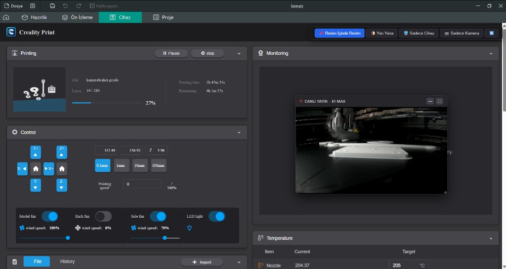
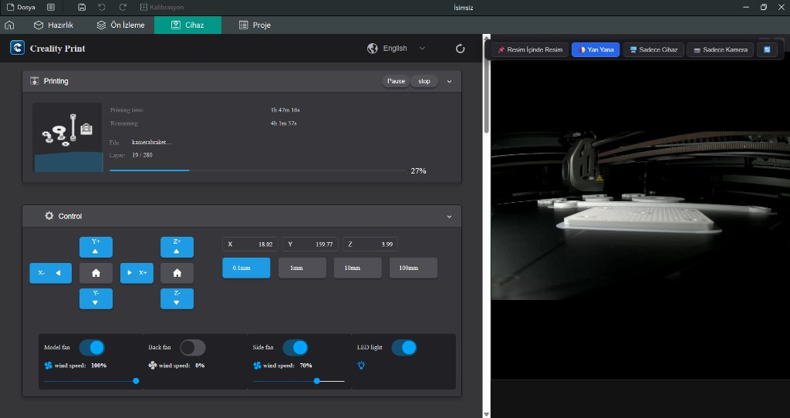
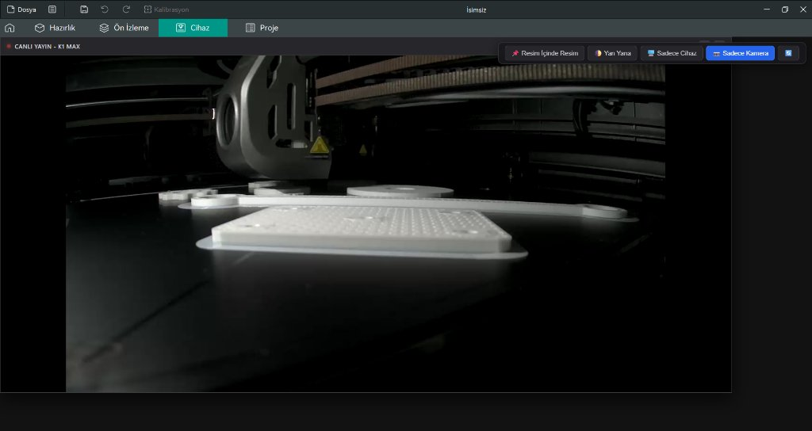

# Creality_Cam_Fix 🖨️📷
### Zero-Root Camera & Unified Dashboard Fix for Creality K1 / K1 Max / K1C in OrcaSlicer
**Specifically designed for Firmware 1.3.5.22+ camera blackout issues without requiring Root/SSH.**

[](https://www.creality.com/)
[](#)
[](https://github.com/SoftFever/OrcaSlicer)
[](https://github.com/okanyyurt/Creality_Cam_Fix/releases/latest)
[-success?logo=windows)](https://github.com/okanyyurt/Creality_Cam_Fix/releases/download/v1.0.0/Creality_Cam_Fix_v1.0.0_Windows_Portable.zip)
[](https://opensource.org/licenses/MIT)

[English](#english) | [Türkçe](#türkçe)

---

## 📸 Screenshots / Ekran Görüntüleri

| Resim İçinde Resim (PiP) | Yan Yana (Split View) | Sadece Kamera (Fullscreen) |
| :---: | :---: | :---: |
|  |  |  |
| *Yazıcı kontrol paneli + yüzen canlı kamera* | *Sol taraf yazıcı kontrolleri, sağ taraf kamera* | *Tam ekran canlı WebRTC yayını* |

---

<a name="english"></a>
## 🇬🇧 English

### 📌 The Problem with Firmware 1.3.5.22+
Starting with **Creality OS firmware 1.3.5.22** on K1, K1 Max, and K1C printers:
* Creality permanently **closed the legacy MJPEG camera port `8080`** (`/?action=stream`).
* The camera feed was locked exclusively into an internal WebRTC service on port `8000`.
* As a result, **OrcaSlicer completely lost the camera view** (showing a black or broken screen in the Device tab).
* Existing forum workarounds require opening Root/SSH access, editing internal printer files, and risking warranty loss or OTA update breakage.

### 💡 The Solution: Creality_Cam_Fix
**Creality_Cam_Fix** is a zero-root background bridge that runs entirely on your PC:
1. **Auto-Discovery:** Automatically scans your local Wi-Fi/Ethernet network to find your printer's IP.
2. **WebRTC Transcoder:** Converts Creality's locked port 8000 WebRTC stream into low-latency WebRTC and MJPEG via `go2rtc`.
3. **Unified Dashboard:** Integrates both your **native Creality controls** (temperatures, print progress %, pause/cancel, axes) and the **live camera** into OrcaSlicer's Device tab with one click.
4. **Dynamic IP Tracking:** If your router changes the printer's IP address, the bridge detects it and keeps streaming seamlessly.

---

### ⚡ 3-Step Simple Setup

#### Step 1: Download & Run the Bridge
1. Download or clone this repository:
   ```bash
   git clone https://github.com/okanyyurt/Creality_Cam_Fix.git
   cd Creality_Cam_Fix
   ```
2. Double-click **`start_bridge.bat`** (or run `python k1_cam_bridge.py`).  
   *(The bridge will automatically detect your printer on the network and start the camera service.)*

#### Step 2: Configure OrcaSlicer (Only once)
1. Open **OrcaSlicer**.
2. Go to the **Prepare** tab.
3. Click the **Edit (Pen)** icon next to your printer name (e.g. *Creality K1 Max (0.4 nozzle)*).
4. In the **Basic Information** tab, find **Device UI** (`print_host_webui`).
5. Paste this URL:
   ```text
   http://127.0.0.1:1984/dashboard.html
   ```
6. Click the **Save (Disk)** icon in the top right.

#### Step 3: Enjoy!
Click the **Device** tab in OrcaSlicer. Both your printer controls and your live camera will appear together instantly!

#### 💡 Can't find the setting in OrcaSlicer UI? (3 Easy Alternatives)
OrcaSlicer sometimes hides the "Device UI" input box in certain preset views. If you can't find it:

* **Option A — ⚡ One-Click Auto-Patcher:**  
  Double-click **`patch_orcaslicer.bat`** (or run `python patch_orcaslicer.py`). It will automatically scan your computer, locate all your K1/K1 Max profiles, and inject the URL for you!
* **Option B — 🤖 Ask your AI Assistant (Claude / Cursor / ChatGPT / Copilot / Antigravity):**  
  Copy & paste this prompt to your AI coding agent:  
  > *"Open my OrcaSlicer configuration folder (`%APPDATA%\OrcaSlicer\user\default\machine\`), find my active Creality K1 .json profile, and set `"print_host_webui": "http://127.0.0.1:1984/dashboard.html"`."*
* **Option C — 📝 Manual JSON Edit:**  
  Open your machine profile file in Notepad:  
  - Windows: `%APPDATA%\OrcaSlicer\user\default\machine\<Your_Printer>.json`  
  - macOS: `~/Library/Application Support/OrcaSlicer/user/default/machine/<Your_Printer>.json`  
  - Linux: `~/.config/OrcaSlicer/user/default/machine/<Your_Printer>.json`  
  Add `"print_host_webui": "http://127.0.0.1:1984/dashboard.html"` and save.

---

### 🎛️ Viewing Modes (Top Toolbar)
* 📌 **Picture-in-Picture (Default):** Full native Creality control panel with a draggable, resizable live camera window.
* 🌓 **Split View:** Screen split into two (printer controls on the left, live camera on the right).
* 🖥️ **Device Only:** Standard Creality web interface.
* 📷 **Camera Only:** Fullscreen live camera feed.
* 🌐 **Language Switcher:** Instant toggle between English (EN) and Turkish (TR).
* 🔄 **Reload:** Refreshes both web UI and camera feed.

---

<a name="türkçe"></a>
## 🇹🇷 Türkçe

### 📌 1.3.5.22 Güncellemesi Sonrası Yaşanan Sorun
Creality K1, K1 Max ve K1C yazıcılarına gelen **1.3.5.22 firmware güncellemesi** ile birlikte:
* Creality, `8080` portundaki eski MJPEG kamera yayınını (`/?action=stream`) tamamen **kapattı**.
* Kamera akışı sadece `8000` portundaki WebRTC servisine kilitlendi.
* Bu sebeple **OrcaSlicer'ın Cihaz (Device) sekmesinde kamera siyah ekranda kaldı ve görüntü alınamaz oldu**.
* İnternetteki çözümlerin tamamı cihaza root yetkisi açmayı (SSH) gerektiriyor; bu da cihazı garanti dışı bırakma ve orijinal güncellemeleri kaybetme riski taşıyor.

### 💡 Çözüm: Creality_Cam_Fix (Root Gerektirmez)
**Creality_Cam_Fix**, yazıcınıza hiçbir müdahalede bulunmadan, sadece bilgisayarınızda arka planda çalışan güvenli bir köprüdür:
1. **Otomatik IP Bulma:** Ağınızı otomatik tarayarak K1 yazıcınızı bulur.
2. **Kamera Dönüştürücü:** Kilitli WebRTC yayınını `go2rtc` ile OrcaSlicer uyumlu akışa çevirir.
3. **Birleşik Kontrol Ekranı:** OrcaSlicer'da sadece kamerayı değil; **hem orijinal Creality kontrol sayfasını** (sıcaklıklar, fanlar, ilerleme %, durdur/başlat) **hem de canlı kamerayı** aynı ekranda sunar.
4. **Dinamik IP Koruması:** Modemin yazıcıya verdiği IP adresi değişse bile köprü bunu anında fark edip yayını kesintisiz sürdürür.

---

### ⚡ 3 Adımda Kolay Kurulum

#### 1. Adım: Köprüyü İndirin ve Çalıştırın
1. Projeyi indirin:
   ```bash
   git clone https://github.com/okanyyurt/Creality_Cam_Fix.git
   cd Creality_Cam_Fix
   ```
2. Klasördeki **`start_bridge.bat`** dosyasına çift tıklayın *(veya `python k1_cam_bridge.py` çalıştırın)*.  
   *(Köprü yazıcınızı ağda otomatik bulacak ve kamera yayınını başlatacaktır.)*

#### 2. Adım: OrcaSlicer Ayarı (Sadece 1 Kere)
1. **OrcaSlicer**'ı açın.
2. **Hazırla (Prepare)** sekmesinde, Yazıcı adınızın yanındaki **Kalem (Düzenle)** simgesine tıklayın.
3. **Temel Bilgiler (Basic information)** sekmesinde aşağı kaydırıp **Cihaz Arayüzü (Device UI / print_host_webui)** kutusuna şunu yapıştırın:
   ```text
   http://127.0.0.1:1984/dashboard.html
   ```
4. Sağ üstteki **Kaydet (Disket)** simgesine basın.

#### 3. Adım: Hepsi Bu Kadar!
OrcaSlicer'da **"Cihaz"** sekmesine tıklayın. Artık hem tüm yazıcı kontrolleriniz hem de canlı kameranız aynı anda karşınızda!

#### 💡 Menüde Kutucuğu Bulamadınız mı? (3 Kolay Alternatif)
Bazı OrcaSlicer sürümlerinde veya profillerinde "Cihaz Arayüzü" kutusu gizlenebilir. Eğer arayüzde bulamadıysanız şu 3 kolay yöntemden birini seçebilirsiniz:

* **Yol 1 — ⚡ Tek Tıkla Otomatik Yamalayıcı:**  
  Klasördeki **`patch_orcaslicer.bat`** dosyasına çift tıklayın *(veya `python patch_orcaslicer.py` çalıştırın)*. Bilgisayarınızdaki tüm K1/K1 Max profillerini saniyeler içinde otomatik olarak bulup ayarı sizin yerinize yapar!
* **Yol 2 — 🤖 Yapay Zeka Ajanınıza (Claude / Cursor / ChatGPT / Copilot / Antigravity) Yaptırın:**  
  AI asistanınıza şu hazır komutu kopyalayıp yapıştırmanız yeterlidir:  
  > *"OrcaSlicer ayar klasörüme git (`%APPDATA%\OrcaSlicer\user\default\machine\`), aktif Creality K1 yazıcı profilimin JSON dosyasını bul ve içine `"print_host_webui": "http://127.0.0.1:1984/dashboard.html"` satırını ekle."*
* **Yol 3 — 📝 Manuel JSON Düzenleme:**  
  Not Defteri ile şu dizindeki yazıcı profilinizi açın:  
  `%APPDATA%\OrcaSlicer\user\default\machine\<Yazıcı_Profiliniz>.json`  
  İçine `"print_host_webui": "http://127.0.0.1:1984/dashboard.html"` satırını ekleyip kaydedin.

---

### 🎛️ Kullanabileceğiniz Görünüm Modları
* 📌 **Resim İçinde Resim (Varsayılan):** Yazıcı kontrolleri tam ekran, canlı kamera sağ altta yüzen pencere olarak oynar. İstediğiniz yere sürükleyebilir veya kenarından tutup büyütebilirsiniz.
* 🌓 **Yan Yana (Split):** Ekranı ikiye böler; solda kontroller, sağda büyük canlı kamera.
* 🖥️ **Sadece Cihaz:** Klasik Creality sayfası.
* 📷 **Sadece Kamera:** Tam ekran kamera yayını.
* 🌐 **Dil Seçici:** Tek tıkla Türkçe ve İngilizce geçişi.

---

### 📄 Lisans / License
Bu proje [MIT Lisansı](LICENSE) ile korunmaktadır.  
This project is licensed under the MIT License - see the [LICENSE](LICENSE) file for details.
