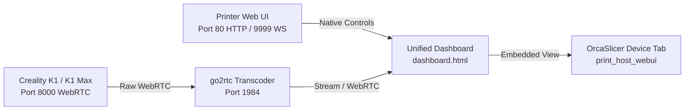

# Creality_Cam_Fix 🖨️📷
### Zero-Root Camera & Unified Dashboard Bridge for Creality K1 / K1 Max / K1C in OrcaSlicer

[](https://opensource.org/licenses/MIT)
[](https://www.python.org/)
[](https://github.com/SoftFever/OrcaSlicer)
[](https://www.creality.com/)
[](#)

[English](#english) | [Türkçe](#türkçe)

---

<a name="english"></a>
## 🇬🇧 English

### 📌 The Problem
In recent firmware updates for the **Creality K1, K1 Max, and K1C**, Creality disabled the legacy MJPEG camera stream on port `8080` (`/?action=stream`) and migrated the camera exclusively to internal WebRTC on port `8000`.

While the Creality Cloud mobile app and Creality Print can still access the camera, **OrcaSlicer** and third-party slicers lost camera visibility. Most existing workarounds require rooting the printer via SSH. However, many users **do not want to root their printer** due to:
* Preserving official warranty.
* Retaining OTA stock firmware updates.
* Avoiding the risk of bricking or system instability.

### 💡 The Solution: Creality_Cam_Fix
**Creality_Cam_Fix** is a lightweight, zero-root local bridge running on your host computer:
1. **Auto-Discovery:** Automatically discovers your printer's LAN IP without manual network configuration.
2. **WebRTC to MJPEG / WebRTC Transcoding:** Uses `go2rtc` to convert Creality's raw WebRTC stream into standard formats compatible with modern slicers.
3. **Unified Dashboard for OrcaSlicer:** Instead of replacing the Device tab with just a camera, it provides a unified bilingual interface with **full printer controls** (temperatures, fans, axes, print job pause/cancel) plus a **floating Picture-in-Picture (PiP) / Split View live camera stream**.
4. **DHCP Resilience:** If your router assigns a new IP to your printer, the bridge detects it and updates the stream automatically.

---

### 🚀 Key Features
* 🔒 **Zero-Root Required:** 100% safe, non-invasive, works with stock factory firmware.
* 🔍 **Automatic IP Discovery:** Detects printer IP via OrcaSlicer API, subnet scanning, or mDNS.
* 🖥️ **Unified Control & Camera View:**
  * **📌 Picture-in-Picture (Default):** Full native Creality control interface with a draggable, resizable live camera window.
  * **🌓 Split View:** Side-by-side view with printer controls on the left and live camera on the right.
  * **🖥️ Device Only:** Standard Creality web interface.
  * **📷 Camera Only:** Fullscreen live camera feed.
* 🌐 **Bilingual Interface:** One-click language switch between **English (EN)** and **Turkish (TR)**.
* ⚡ **Ultra Low Latency:** Direct WebRTC streaming with automatic MJPEG fallback.
* 📦 **Plug & Play:** Auto-downloads required `go2rtc` binary if missing.

---

### 🏗️ Architecture



---

### 📦 Installation & Quick Start

#### 1. Clone the Repository
```bash
git clone https://github.com/okanyyurt/Creality_Cam_Fix.git
cd Creality_Cam_Fix
```

#### 2. Run the Bridge
Simply double-click `start_bridge.bat` (or run via terminal):
```bash
python k1_cam_bridge.py
```
*The script will automatically detect your printer on the local network, configure `go2rtc`, and start the services.*

#### 3. Configure OrcaSlicer
1. Open **OrcaSlicer**.
2. Go to the **Prepare** tab.
3. Next to your Printer profile (e.g. `Creality K1 Max (0.4 nozzle)`), click the **Edit (Pen)** icon.
4. Under the **Basic Information** (or **General**) tab, scroll down to **Device UI** (`print_host_webui`).
5. Enter:
   ```text
   http://127.0.0.1:1984/dashboard.html
   ```
6. Click **Save**.
7. Switch to the **Device** tab in OrcaSlicer: your full control page and live camera are now streaming!

---

<a name="türkçe"></a>
## 🇹🇷 Türkçe

### 📌 Sorun Nedir?
**Creality K1, K1 Max ve K1C** serisi için yayınlanan son yazılım güncellemelerinde Creality, `8080` portundaki eski MJPEG kamera akışını (`/?action=stream`) kapattı ve kamerayı sadece `8000` portundaki WebRTC protokolüne taşıdı.

Bu durum Creality Cloud ve Creality Print uygulamasında çalışmaya devam etse de, **OrcaSlicer** gibi popüler dilimleyicilerde kameranın tamamen kaybolmasına (siyah ekran) neden oldu. İnternetteki çözümlerin neredeyse tamamı yazıcıya root yetkisi açmayı (SSH) gerektirmektedir. Ancak birçok kullanıcı:
* Garantinin bozulmaması,
* Orijinal güncellemelerin sorunsuz alınması,
* Cihazın kilitlenme riskine girmemesi için **root açmak istememektedir**.

### 💡 Çözüm: Creality_Cam_Fix
**Creality_Cam_Fix**, bilgisayarınızda yerel olarak çalışan sıfır root gerektiren bir köprü uygulamasıdır:
1. **Otomatik IP Keşfi:** Ağınızdaki K1 yazıcınızı otomatik olarak bulur.
2. **Kamera Dönüştürücü:** `go2rtc` altyapısıyla yazıcının WebRTC yayınını OrcaSlicer ile %100 uyumlu MJPEG/WebRTC akışına dönüştürür.
3. **Birleşik Dashboard (Kontrol & Kamera):** Cihaz sekmesini sadece kamerayla doldurmak yerine; **tüm orijinal Creality kontrollerini** (sıcaklıklar, fanlar, eksen hareketleri, durdur/başlat) ve **yüzen / yeniden boyutlandırılabilir canlı kamerayı** tek bir ekranda sunar.
4. **Dinamik IP Koruması:** Modemin yazıcıya verdiği IP adresi değişse bile köprü bunu anında fark edip yayını kesintisiz günceller.

---

### 🚀 Öne Çıkan Özellikler
* 🔒 **Root Yetkisi İstemez:** %100 güvenli, orijinal fabrika yazılımıyla tam uyumlu.
* 🔍 **Otomatik Ağ Taraması:** IP adresini otomatik bulur, elle yazma derdini bitirir.
* 🖥️ **Çoklu Görüntüleme Modları:**
  * **📌 Resim İçinde Resim (Varsayılan):** Orijinal Creality kontrol paneli tam ekran + sağ altta sürüklenebilir canlı kamera.
  * **🌓 Yan Yana (Split):** Sol tarafta yazıcı kontrolleri, sağ tarafta canlı kamera.
  * **🖥️ Sadece Cihaz:** Orijinal Creality ekranı.
  * **📷 Sadece Kamera:** Tam ekran kamera yayını.
* 🌐 **İki Dilli Arayüz:** Tek tıkla **Türkçe (TR)** ve **İngilizce (EN)** geçişi.
* ⚡ **Sıfır Gecikme:** WebRTC hızında akıcı canlı yayın.

---

### 📦 Hızlı Başlangıç

1. Projeyi indirin veya klonlayın:
   ```bash
   git clone https://github.com/okanyyurt/Creality_Cam_Fix.git
   cd Creality_Cam_Fix
   ```
2. `start_bridge.bat` dosyasına çift tıklayın *(veya `python k1_cam_bridge.py` çalıştırın)*.
3. **OrcaSlicer Ayarı:**
   * OrcaSlicer'da **Hazırla** sekmesinde Yazıcı adının yanındaki **Kalem (Düzenle)** simgesine tıklayın.
   * **Temel Bilgiler** sekmesinde **Cihaz Arayüzü** (`print_host_webui`) kutusuna:
     ```text
     http://127.0.0.1:1984/dashboard.html
     ```
     yazıp **Kaydet**'e basın.
   * **Cihaz** sekmesine geçin, hem yazıcı kontrolleriniz hem de canlı kameranız anında hazır!

---

### 📂 Proje Yapısı / Project Structure
```text
Creality_Cam_Fix/
├── www/
│   ├── dashboard.html    # Unified bilingual control dashboard with PiP & WebRTC
│   └── index.html        # Root dashboard mirror
├── go2rtc.exe            # High-performance streaming bridge binary
├── go2rtc.yaml           # Auto-generated streaming configuration
├── k1_cam_bridge.py      # Core Python bridge: auto-discovery & monitor daemon
├── requirements.txt      # Python dependencies
├── start_bridge.bat      # One-click Windows startup script
├── LICENSE               # MIT License
└── README.md             # Project documentation (EN / TR)
```

---

### 📄 Lisans / License
Bu proje [MIT Lisansı](LICENSE) altında açık kaynak olarak sunulmuştur.  
This project is licensed under the MIT License - see the [LICENSE](LICENSE) file for details.

Developed with ❤️ for the 3D Printing & Creality community.
